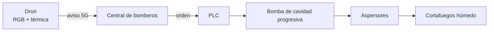

# S.P.I.T.

### Sistema de Prevención de Incendios Tempranos

*Early Wildfire Prevention System*

**Detectar el fuego en los primeros minutos. Mojar la línea por la que iba a avanzar.**

[▶ Ver el vídeo completo (5 min)](media/SPIT-presentacion.mp4) · [Ver el cartel](media/cartel.jpg) · [Leer la memoria](docs/SPIT-documento-tecnico.pdf)

---

## El proyecto

**S.P.I.T.** es un sistema de **prevención temprana de incendios forestales** para zonas de alto riesgo. Combina dos cosas que normalmente van por separado: **ojos** que vigilan el monte las 24 horas y **manos** que actúan sobre el terreno en cuanto hay una señal de fuego.

La idea es sencilla: si el incendio se detecta cuando todavía es un conato —un fuego que acaba de empezar— y se frena la línea por la que iba a avanzar, se gana el recurso más valioso de una emergencia: **tiempo**.

El proyecto se presentó en el **hackathon WED 2026** de la **EINA (Universidad de Zaragoza)** con el equipo **InnoviZar**.

## El problema

El cambio climático está alargando la temporada de incendios y secando el combustible. En España, 2025 dejó **más de 390.000 hectáreas quemadas**, 7 personas fallecidas y 30.000 evacuadas. Es una superficie comparable a la provincia de Málaga.

El problema no es solo la cantidad de fuego: es la velocidad a la que se convierte en una emergencia. Un cortafuegos tradicional detiene el avance entre el **60 % y el 65 %** de las veces. En casi cuatro de cada diez casos, el fuego lo cruza.

Cuando llegan los medios aéreos y terrestres, el incendio ya suele tener la delantera. La ventana en la que se decide todo es muy corta: **los primeros minutos**.

Cuanto más pequeño es el fuego, más barato es pararlo.
Datos: guión y memoria del proyecto; bibliografía completa en la <a href="docs/SPIT-documento-tecnico.pdf">memoria técnica</a>.

## Cómo funciona

Dos fases: una **mira** y la otra **actúa**. Todo pasa por la central de bomberos, que recibe el aviso, lo valida y decide.

### Fase 1 · Vigilancia y aviso

**1. Patrulla.** Drones UAV vuelan por turnos, 24 horas al día, sobre las zonas con más probabilidad de ignición. Siguen rutas automáticas a unos **300 m** de altura y cubren del orden de **24 hectáreas por pasada**. Cada dron tiene unos **45 minutos** de autonomía; hay estaciones de recarga automática en los puntos de control.

**2. Detecta.** Cada dron lleva cámara **RGB y térmica**. A bordo corre un modelo de IA (TinyML: inteligencia artificial que cabe en el propio dron) entrenado con conjuntos de datos especializados como PyroNear2024, FAME 3 y AUVs-FDDB, además de vuelos propios. Busca calor anómalo y columnas de humo.

**3. Avisa.** El dron no transmite vídeo continuamente: envía solo el aviso por **5G** cuando algo le parece un conato. Eso ahorra datos y, sobre todo, tiempo de respuesta. En la central, una persona confirma el aviso antes de actuar.

> El dron no manda vídeo: manda un aviso. Lo importante no es ver el fuego, sino saber dónde está cuanto antes.

El dron detecta una columna de humo y manda la alerta. La decisión sigue siendo humana.

### Fase 2 · Cortafuegos húmedo

**1. Se confirma el fuego.** La central valida la alerta y activa el protocolo.

**2. Se moja la línea.** Una red de aspersores agrícolas, instalada en cortafuegos que ya existen, rocía los laterales del sector. Para 10 ha: **400 aspersores cada 3,2 m** y **1,25 km** de perímetro.

**3. Se dosifica el agente.** El agua se mezcla con **EcoFire**, un agente biodegradable, en depósitos de **10.000 L**. Bombas de cavidad progresiva lo impulsan entre **7 y 48 bar** según el desnivel. Un **PLC** —el controlador industrial— vigila la presión y el caudal con sensores para mantener el flujo estable y detectar fallos.

**4. Se confina.** La franja mojada baja la temperatura, empapa el combustible y corta su continuidad. El fuego encuentra una línea mucho más difícil de cruzar y los equipos ganan un corredor de trabajo.

La franja tratada no es una pared: es una línea que el fuego cruza peor y más despacio.

Esquema de control: PLC, bomba, aspersores, caudalímetros y sensores de presión.

**No sustituye a los bomberos.** Les da minutos. La diferencia entre un conato y un incendio de nivel 2 o 3 suele estar en esos primeros minutos.

## Por qué funciona

Para que un incendio avance hacen falta calor, combustible y oxígeno. S.P.I.T. no puede quitarle el oxígeno a un bosque, pero sí atacar los otros dos.

**Agua + EcoFire** absorben calor (el agua evapora) y empapan el combustible, que tarda más en prender. El agente también penetra en los materiales porosos y reduce la continuidad del combustible. Es la misma idea que mojar el perímetro de una hoguera, pero a escala de 1,25 km.

EcoFire es biodegradable y evita las espumas con PFAS, que dejan contaminantes persistentes en el suelo y el agua. Es más denso y viscoso que el agua (**1,145 kg/m³** y **27,40 mPa·s**), así que el diseño usa bombas de cavidad progresiva, que mantienen el caudal con líquidos viscosos.

El resultado estimado: la probabilidad de que el fuego cruce la franja baja del **60–65 %** a cerca del **20–30 %**. Además, la franja puede actuar como **corredor de vida**: una zona más segura por la que los bomberos pueden moverse y trabajar.

## El sistema en números

| Magnitud | Valor |
|---|---|
| Superficie protegida | 10 ha (100.000 m²) |
| Aspersores | 400, separados 3,2 m |
| Perímetro tratado | 1,25 km |
| Aplicación | 3.160 L de EcoFire en 30 min |
| Caudal | 105 L/min |
| Presión | 7–48 bar según el desnivel |
| Depósito nodriza | 10.000 L |
| Drones | 2 · 45 min de autonomía · 300 m |
| Cobertura | 24 ha por pasada |
| Inversión estimada | 43.000 € · 4.300 €/ha |
| Reducción de paso | del 60–65 % a ~20–30 % |

Cifras de diseño para una parcela de 10 ha. Son estimaciones, no medidas de un despliegue real.

## ODS

S.P.I.T. se alinea con el **ODS 9** (industria, innovación e infraestructura), el **ODS 13** (acción por el clima) y el **ODS 15** (vida de ecosistemas terrestres).

## El equipo

**Equipo InnoviZar** · Hackathon WED 2026 · EINA, Universidad de Zaragoza

| Nombre | Formación |
|---|---|
| **Daniela Rodríguez** | Ingeniería Mecánica |
| **Ismael Al-Zurba** | Ingeniería Mecánica |
| **Leyre Barrau** | Ingeniería de Diseño |
| **Sergio Toro** | Ingeniería Electrónica |

## Estado y alcance

**S.P.I.T. es un concepto de ingeniería, no un producto desplegado.** Se presentó en el hackathon WED 2026 y este repositorio reúne la documentación y el material audiovisual. El código fuente no forma parte del repositorio.

Los datos son estimaciones de diseño y el vídeo es una simulación visual. El siguiente paso sería validar el sistema en campo, con un piloto en una parcela real y la coordinación de los servicios de extinción.

Si quieres retomarlo, colaborar o proponer una prueba, abre un [issue](https://github.com/sejotta/SPIT-wefohackaton2026/issues).

## Documentos

| Documento | Contenido |
|---|---|
| [Memoria técnica](docs/SPIT-documento-tecnico.pdf) | 2 páginas, en inglés. Resumen del sistema, fundamentos y bibliografía. |
| [Guión del vídeo](docs/SPIT-guion-video.pdf) | 12 páginas, español e inglés. El texto completo de la presentación. |
| [Diagrama de control](docs/SPIT-diagrama-control.pdf) | Esquema de PLC, bomba, sensores, aspersores y comunicaciones. |
| [Cartel del hackathon](docs/SPIT-cartel.pdf) | Póster presentado en la EINA. También disponible en [JPG](media/cartel.jpg). |

## Licencia

© 2026 Daniela Rodríguez, Ismael Al-Zurba, Leyre Barrau y Sergio Toro. **Todos los derechos reservados.**

No se permite copiar, modificar, distribuir ni reutilizar este proyecto —textos, imágenes, vídeos, diagramas o diseño— sin permiso previo y por escrito. Si quieres usar o adaptar algo, abre un issue o contacta con [@sejotta](https://github.com/sejotta).

[Leer la licencia completa](LICENSE).

EcoFire es una marca de sus respectivos titulares. Los logotipos de la Universidad de Zaragoza, la EINA, Naciones Unidas y la Agenda 2030 pertenecen a sus titulares.

---

<strong>English summary</strong>

**S.P.I.T. (Early Wildfire Prevention System)** is a two-phase concept for high-risk forest interfaces:

1. **Prevention and early warning** — UAVs patrol 24/7 with RGB + thermal cameras and on-board TinyML. Rather than streaming video, they send alerts over 5G to the fire station, where a person validates the event.
2. **Action** — a remotely activated wet fuelbreak: sprinklers installed along existing firebreaks spray a biodegradable EcoFire solution, confining the fire while firefighters arrive.

For a 10 ha area: ~400 sprinklers every 3.2 m, a 1.25 km perimeter, 3,160 L of EcoFire applied in 30 min at 105 L/min, 7–48 bar, and a 10,000 L buffer. Estimated cost: €43k (€4.3k/ha). The treated strip is expected to lower the probability of fire crossing from ~60–65% to ~20–30%.

Concept project by Team InnoviZar (EINA, University of Zaragoza) for the WED 2026 hackathon. No source code is published. All rights reserved; copying or reuse requires prior written permission.

---

  Hecho en Zaragoza · Hackathon WED 2026 · EINA · Universidad de Zaragoza 
  © 2026 Equipo InnoviZar. Todos los derechos reservados.

