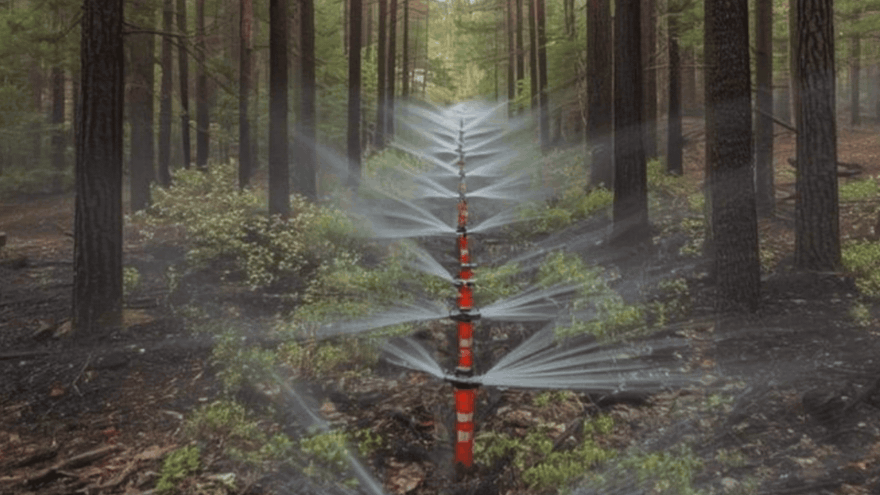
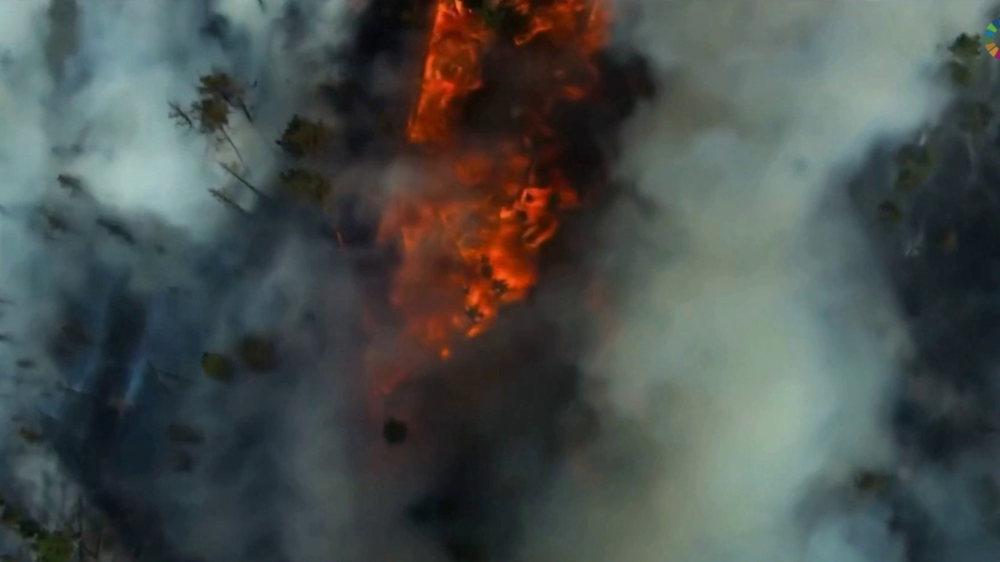
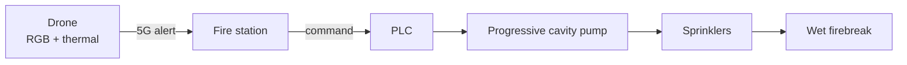
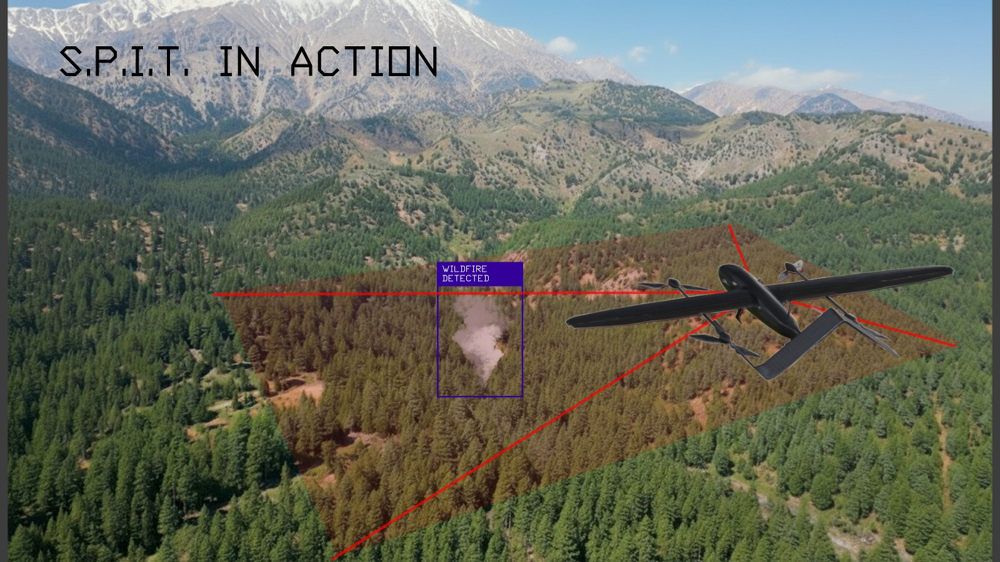
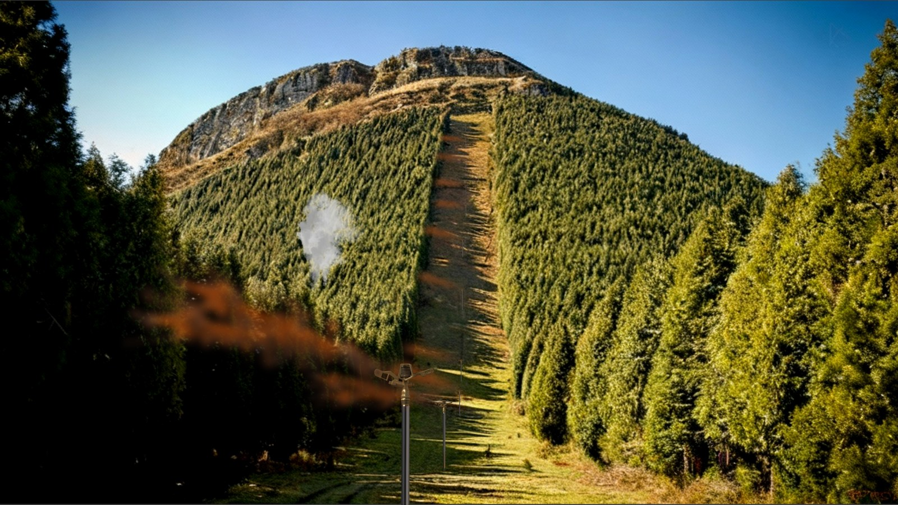
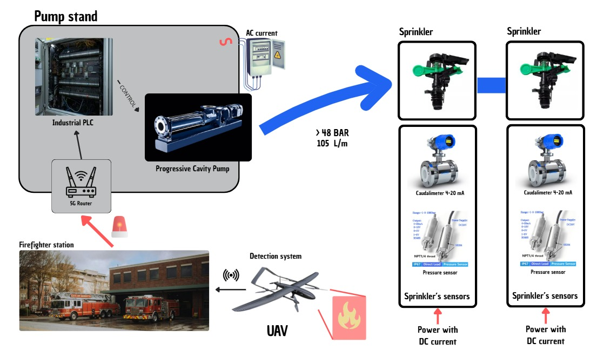
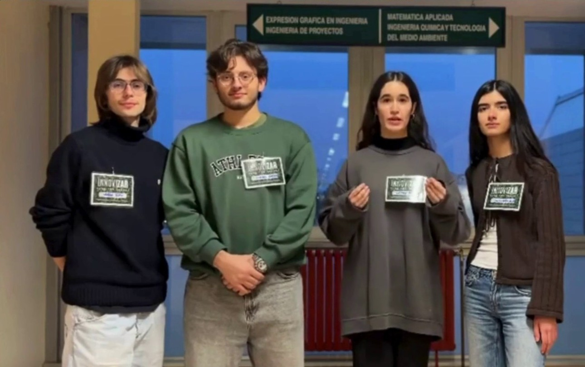

# S.P.I.T.

### Early Wildfire Prevention System

**Detect the fire in its first minutes. Wet the line it was about to cross.**

[▶ Watch the full video (5 min)](media/SPIT-presentacion.mp4) · [View the poster](media/cartel.jpg) · [Read the technical brief](docs/SPIT-documento-tecnico.pdf)

---

## The project

**S.P.I.T.** is an **early wildfire prevention system** for high-risk areas. It combines two things that usually work separately: **eyes** that watch the forest 24 hours a day and **hands** that act on the ground as soon as there is a sign of fire.

The idea is simple: if a fire is detected while it is still small — one that has just started — and the line it was about to cross is wetted, the most valuable resource in an emergency is gained: **time**.

The project was presented at the **WED 2026 Hackathon**, hosted by **EINA (University of Zaragoza)**, with team **InnoviZar**.

## The problem

Climate change is lengthening the fire season and drying out fuel. In Spain, 2025 left **more than 390,000 hectares burned**, 7 people dead, and 30,000 evacuated. That is an area comparable to the province of Málaga.

The problem is not only the amount of fire: it is the speed at which it becomes an emergency. A traditional firebreak stops the spread **60–65%** of the time. In almost four out of ten cases, the fire crosses it.

By the time aerial and ground crews arrive, the fire usually has the upper hand. The window in which everything is decided is very short: **the first minutes**.

The smaller the fire, the cheaper it is to stop.
Data: project script and technical brief; full bibliography in the <a href="docs/SPIT-documento-tecnico.pdf">technical brief</a>.

## How it works

Two phases: one **watches** and the other **acts**. Everything goes through the fire station, which receives the alert, validates it, and decides.

### Phase 1 · Surveillance and alert

**1. Patrol.** Drones (UAVs) fly in shifts, 24 hours a day, over the areas most likely to ignite. They follow automatic routes at about **300 m** altitude and cover around **24 hectares per pass**. Each drone has about **45 minutes** of endurance; automatic recharging stations are placed at control points.

**2. Detect.** Each drone carries **RGB and thermal** cameras. An on-board AI model (TinyML: artificial intelligence that fits on the drone itself) is trained on specialized datasets such as PyroNear2024, FAME 3, and AUVs-FDDB, plus its own flight data. It looks for anomalous heat and smoke plumes.

**3. Alert.** The drone does not stream video continuously: it sends only the alert over **5G** when something looks like a small fire. That saves data and, above all, response time. At the station, a person confirms the alert before acting.

> The drone does not send video: it sends an alert. What matters is not seeing the fire, but knowing where it is as soon as possible.

The drone detects a smoke plume and sends the alert. The decision remains human.

### Phase 2 · Wet firebreak

**1. Confirmation.** The station validates the alert and activates the protocol.

**2. The line is wetted.** A network of agricultural sprinklers, installed along existing firebreaks, sprays the sides of the sector. For 10 ha: **400 sprinklers every 3.2 m** and **1.25 km** of perimeter.

**3. The agent is dosed.** Water is mixed with **EcoFire**, a biodegradable agent, in **10,000 L** tanks. Progressive cavity pumps push it at **7–48 bar** depending on elevation. A **PLC** — the industrial controller — monitors pressure and flow with sensors to keep the flow stable and detect failures.

**4. The fire is confined.** The wet strip lowers the temperature, soaks the fuel, and breaks its continuity. The fire faces a line that is much harder to cross, and crews gain a working corridor.

The treated strip is not a wall: it is a line the fire crosses worse and more slowly.

Control diagram: PLC, pump, sprinklers, flowmeters, and pressure sensors.

**It does not replace firefighters.** It gives them minutes. The difference between a small fire and a level 2 or 3 fire is often those first minutes.

## Why it works

A fire needs heat, fuel, and oxygen to spread. S.P.I.T. cannot take oxygen out of a forest, but it can attack the other two.

**Water + EcoFire** absorb heat (water evaporates) and soak the fuel, which takes longer to ignite. The agent also penetrates porous materials and reduces fuel continuity. It is the same idea as wetting the edge of a campfire, but at the scale of 1.25 km.

EcoFire is biodegradable and avoids PFAS foams, which leave persistent contaminants in soil and water. It is denser and more viscous than water (**1.145 kg/m³** and **27.40 mPa·s**), so the design uses progressive cavity pumps, which maintain flow with viscous liquids.

The estimated result: the probability of fire crossing the strip drops from **60–65%** to around **20–30%**. The strip can also act as a **life corridor**: a safer area where firefighters can move and work.

## The system in numbers

| Metric | Value |
|---|---|
| Protected area | 10 ha (100,000 m²) |
| Sprinklers | 400, spaced 3.2 m apart |
| Treated perimeter | 1.25 km |
| Application | 3,160 L of EcoFire over 30 min |
| Flow rate | 105 L/min |
| Pressure | 7–48 bar depending on elevation |
| Buffer tank | 10,000 L |
| Drones | 2 · 45 min endurance · 300 m |
| Coverage | 24 ha per pass |
| Estimated investment | €43,000 · €4,300/ha |
| Crossing reduction | from 60–65% to ~20–30% |

Design figures for a 10 ha plot. They are estimates, not measurements from a real deployment.

## SDGs

S.P.I.T. aligns with **SDG 9** (Industry, Innovation and Infrastructure), **SDG 13** (Climate Action), and **SDG 15** (Life on Land).

## The team

**Team InnoviZar** · WED 2026 Hackathon · EINA, University of Zaragoza

| Name | Field |
|---|---|
| **Daniela Rodríguez** | Mechanical Engineering |
| **Ismael Al-Zurba** | Mechanical Engineering |
| **Leyre Barrau** | Design Engineering |
| **Sergio Toro** | Electronic Engineering |

## Status and scope

**S.P.I.T. is an engineering concept, not a deployed product.** It was presented at the WED 2026 Hackathon, and this repository gathers the documentation and audiovisual material. The source code is not part of the repository.

The figures are design estimates, and the video is a visual simulation. The next step would be to validate the system in the field, with a pilot on a real plot and coordination with firefighting services.

If you want to pick it up, collaborate, or propose a trial, open an [issue](https://github.com/sejotta/SPIT-wefohackaton2026/issues).

## Documents

| Document | Contents |
|---|---|
| [Technical brief](docs/SPIT-documento-tecnico.pdf) | 2 pages, in English. System overview, rationale, and bibliography. |
| [Video script](docs/SPIT-guion-video.pdf) | 12 pages, in Spanish and English. Full presentation script. |
| [Control diagram](docs/SPIT-diagrama-control.pdf) | PLC, pump, sensors, sprinklers, and communications. |
| [Hackathon poster](docs/SPIT-cartel.pdf) | Spanish-language poster presented at EINA. Also available as [JPG](media/cartel.jpg). |

## License

© 2026 Daniela Rodríguez, Ismael Al-Zurba, Leyre Barrau, and Sergio Toro. **All rights reserved.**

No part of this project — text, images, videos, diagrams, or design — may be copied, modified, distributed, or reused without prior written permission. To use or adapt something, open an issue or contact [@sejotta](https://github.com/sejotta).

[Read the full license](LICENSE).

EcoFire is a trademark of its respective owners. The logos of the University of Zaragoza, EINA, the United Nations, and the 2030 Agenda belong to their respective owners.

---

  Made in Zaragoza · WED 2026 Hackathon · EINA · University of Zaragoza 
  © 2026 Team InnoviZar. All rights reserved.

